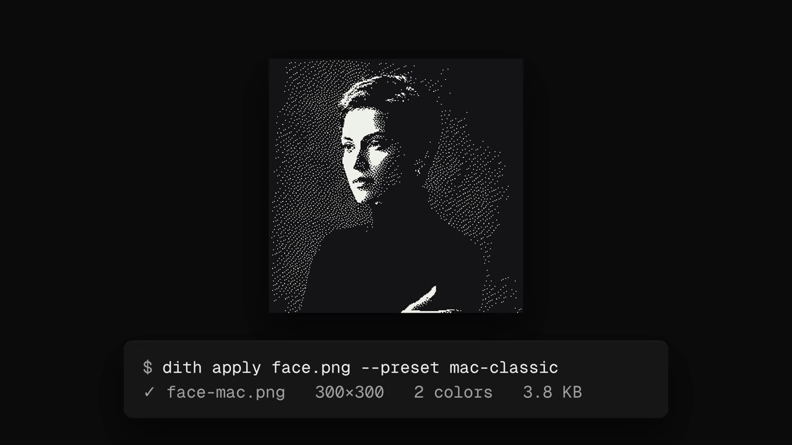

# `dith`

An agent-friendly Rust CLI toolkit for crafting beautiful dithers, halftones, Risograph prints, retro pixel art, procedural dither graphics, looping animations, vector SVGs, and labeled comparison sheets.

[](https://api.capy.ai/pr-assets/v_du0_ues8xfb4Lifuj-HtnI_pSsbZZuOiid8moJSMreY.mp4)

[Watch the 55-second intro](https://api.capy.ai/pr-assets/v_du0_ues8xfb4Lifuj-HtnI_pSsbZZuOiid8moJSMreY.mp4). Every image in it is real `dith` output.

## Highlights

- **Perceptually accurate color engine**: Linear-light error diffusion + Björn Ottosson's **Oklab** perceptual nearest-color matching (with `--color-space oklab|linear|srgb`).
- **24 dithering algorithms**:
  - *Error diffusion*: `floyd-steinberg`, `atkinson`, `jarvis-judice-ninke` (`jjn`), `stucki`, `burkes`, `sierra`, `sierra-two-row`, `sierra-lite`, `ostromoukhov` (tone-adaptive variable coefficients)
  - *Ordered & print screens*: `bayer2`, `bayer4`, `bayer8`, `bayer16`, `halftone`, `clustered-dot`, `diagonal-lines`, `horizontal-lines`, `vertical-lines`, `crosshatch`
  - *Stochastic & space-filling*: `blue-noise` (64x64 Void-and-Cluster), `ign` (Interleaved Gradient Noise), `riemersma` (Hilbert curve), `random`, `threshold`
- **29+ curated palettes + custom & adaptive**: Built-ins (`bw`, `mac-1bit`, `newsprint`, `ink-cream`, `risograph-blue`, `risograph-red`, `risograph-duo`, `blueprint`, `sepia`, `amber-crt`, `phosphor-green`, `gameboy`, `cobalt-sand`, `vermilion-paper`, `sunset-dusk`, `cyber-magenta`, `pico8`, `nord`, `gruvbox`, `catppuccin`, `cmyk`, `grayN`, `rgb332`, `web216`), inline `--colors "#111,#f5efe6"`, palette files (`.hex`, `.gpl`, `.json`), and `--auto-palette N` (Oklab k-means++ extraction).
- **15 built-in presets + persistent local presets**: Built-ins (`mac-classic`, `editorial-print`, `film-stipple`, `risograph`, `risograph-red`, `risograph-duo`, `gameboy`, `crt-amber`, `phosphor`, `blueprint`, `halftone-zine`, `woodcut`, `lo-fi-photo`, `vapor-mesh`, `pico8`) plus saved local presets in `.dith/presets/` (`--scope project`) or `~/.config/dith/presets/` (`--scope user`) via `dith preset save|list|show|delete` or `--save-preset <NAME>`. Any individual flag cleanly overrides a preset.
- **9 procedural generators + seamless animated dithers** (`dith animate`): Create static or seamlessly looping animations (`linear-gradient`, `radial-gradient`, `mesh`, `sphere`, `waves`, `noise`, `rings`, `plasma`, `checkerboard`), re-dither existing GIFs or image sequences with a **shared global palette**, or turn any static photo into an animated Risograph line-boil GIF (`--temporal locked|boil|grain`). Export to exact-palette **GIF**, **APNG**, or lossless **animated WebP** (usually the smallest), CSS **spritesheet**, numbered PNG frames, or play live in fullscreen terminal (`--view`)!
- **Multiple export & terminal preview formats**: `png` (add `--optimize` for the smallest lossless PNG/APNG via palette and filter search plus Zopfli), lossless palette-coded `webp` (usually the smallest lossless file), `jpeg`, `gif`, palettized `bmp`, Deflate-compressed `tiff`, run-length-merged or dotted **vector `svg`**, pixel-exact **Kitty graphics protocol** (`dith preview` and `--view` open **fullscreen by default** on TTYs with `[r]` raw/dither toggle, `[f]` fit/1:1 toggle, `[q/Esc]` quit; pass `--inline` for scrollback), plus Unicode **`braille`** and **`ascii`**.
- **Pen-plotter stippling** (`dith plot`): weighted Voronoi stippling (Secord 2002) of any photo or generator, a nearest-neighbour + 2-opt tour that cuts pen-up travel, and plotter-ready output: physical-size **mm SVG** (one Inkscape layer per pen) or **G-code** with your own pen-up/pen-down commands, feeds, and origin. Paper sizes `a2`–`a6`, `letter`, `legal`, `tabloid`, or `WxHmm`; multi-colour palettes split into one pen layer per colour. 20k points on a 1200px raster take about half a second.
- **Built for AI agents**:
  - `dith capabilities` — one-shot self-describing JSON manifest of every command, algorithm, preset, palette, generator, flag, and range.
  - `--json` global flag — deterministic structured JSON results (dimensions, palette usage histogram, elapsed ms, optional inline Braille preview) and structured JSON errors with `code`, `suggestion`, and `valid_values`.
  - `--dry-run`, `--no-clobber`, `--emit-recipe`, `--recipe <path|->`, stdin/stdout `-`, `inspect`, `compare` contact sheets, and parallel `batch`.

## Install & Update

Prebuilt binaries are published for **macOS Apple Silicon (`aarch64-apple-darwin`)**, **Linux Intel (`x86_64-unknown-linux-gnu`)**, and **Linux ARM (`aarch64-unknown-linux-gnu`)**.

```bash
# Install binary + agent skill (macOS ARM / Linux x86_64 / Linux aarch64)
curl -fsSL https://raw.githubusercontent.com/lassejlv/dith/main/install.sh | bash

# Update to the latest release anytime
dith update

# Or install from source
cargo install --git https://github.com/lassejlv/dith

# Local dev build
mbx build --release
mbx run -- --help
```

An agent skill for using `dith` lives in [`skills/dith/SKILL.md`](skills/dith/SKILL.md).

## Browser playground & npm package

The same engine compiles to WebAssembly, so dithering also runs in the browser and in Node 20+ with byte-identical output.

- **Playground** ([`web/`](web/)): drop an image or pick a generator, tune presets, palettes and sliders with live previews, download PNG/WebP/SVG, and copy the `dith apply` / `dith generate` command (or the recipe JSON) that reproduces the result exactly. It deploys to GitHub Pages from `main`.
- **npm package** [`dith`](npm/): a typed browser library with a worker pool, live-preview helpers, and types generated from the engine (built with Vite+).

```js
import { render } from "dith";

const out = await render(file, { preset: "risograph", maxDim: 1200, format: "webp" });
// out.bytes, out.mime, out.width, out.height, out.report (same fields as `dith apply --json`)
```

Build the WebAssembly module with `scripts/build-wasm.sh` (needs the `wasm32-unknown-unknown` target, `wasm-bindgen`, and optionally `wasm-opt`; `scripts/install-wasm-tools.sh` installs both on Linux x86_64), then run `cd npm && npm ci && npm run build` (types and `vp pack`) and `cd web && npm ci && npx vp dev` for the playground. The library alone builds with `cargo build --lib --target wasm32-unknown-unknown --no-default-features --features wasm`.

## Agent Quickstart

```bash
# 1. Discover everything in a single JSON call
dith capabilities

# 2. Inspect an image & get tailored dithering commands
dith inspect photo.png --json

# 3. Visually compare multiple looks on a labeled contact sheet
dith compare photo.png -o sheet.png \
  --presets mac-classic,editorial-print,risograph,film-stipple --json

# 4. Apply a preset with custom overrides + emit a reusable JSON recipe
dith apply photo.png -o hero.png \
  --preset editorial-print --colors "#111111,#f5efe6,#d93829" \
  --max-dim 1200 --sharpen 0.4 --emit-recipe --json

# 5. Generate procedural dither art from scratch (no input image needed)
dith generate sphere -o orb.svg \
  --preset risograph --canvas-width 160 --canvas-height 160 \
  --svg-shape circle --svg-skip-bg --json

# 6. Instant pixel-exact terminal preview (Kitty, Ghostty, WezTerm) — fullscreen by default!
dith preview photo.png --preset risograph               # fullscreen ([r] raw/dither, [f] fit/1:1, [q/Esc] quit)
dith preview photo.png --preset risograph --inline --cols 60
dith generate sphere --preset gameboy --view
dith compare photo.png --presets mac-classic,editorial-print,risograph,film-stipple --view

# Or save a file AND view it fullscreen right in the terminal
dith apply photo.png -o hero.png --preset mac-classic --view

# 7. Save & reuse local presets (.dith/presets/ for project, or --scope user for global)
dith preset save brand-hero \
  --algorithm blue-noise --colors "#0f172a,#2563eb,#f5efe6" \
  --contrast 0.12 --sharpen 0.3 --auto-levels \
  --description "Brand hero stipple" --tags "brand,hero" --json
dith apply photo.png -o hero.png --preset brand-hero --json
dith preset list --source local --json

# Or save while rendering in one step
dith generate sphere -o orb.png --algorithm atkinson --colors "#111,#f5efe6" --save-preset ink-orb

# 8. Animated dithers (procedural loops, GIF re-dithering, photo boil, sweeps, palette cycling, & live playback!)
dith animate sphere --preset risograph --frames 32 --fps 18 --view   # live fullscreen playback!
dith animate mesh -o aurora.gif --preset vapor-mesh --duration 2.0 --fps 18 --easing ease-in-out
dith animate photo.png -o dissolve.gif --preset mac-classic --sweep-bias -0.45..0.0 --easing ease-out --hold-end 8
dith animate photo.png -o focus.gif --preset gameboy --sweep-pixel-size 12..2 --ping-pong
dith animate photo.png -o zine.gif --preset risograph --temporal boil --boil-rate 2 --boil-amount 0.06 --frames 12 --fps 10
dith animate plasma -o amiga.gif --palette sunset-dusk --algorithm bayer4 --cycle-palette --screen-drift 1,0 --frames 24 --fps 16
dith animate input.gif -o retro.gif --preset gameboy --temporal locked --json
dith animate waves -o waves.webp --preset gameboy --algorithm bayer4 --frames 16   # lossless animated WebP
dith animate rings -o rings-sheet.png --anim-format spritesheet --sheet-cols 6 --frames 12

# 9. Parallel batch processing
dith batch assets/*.png --out-dir ./dithered --preset brand-hero --json

# 10. Pen-plotter stipples (mm SVG or G-code, optimised pen-up tour, JSON report with travel + plot time)
dith plot portrait.jpg -o portrait.svg -n 20000 --paper a4 --edges 0.8 --json
dith plot portrait.jpg -o portrait.gcode -n 20000 --pen-down "M3 S30" --pen-up M5 --dwell 0.15 --draw-feed 3000 --travel-feed 8000
dith plot sphere -o orb.svg --paper a3 --dot circle --min-dot 0.4 --max-dot 1.6 --pen-width 0.3
dith plot mesh -o duo.svg --colors "#111111,#e11d48,#ffffff" --stops "#111111,#e11d48,#ffffff"   # one layer per pen
```
